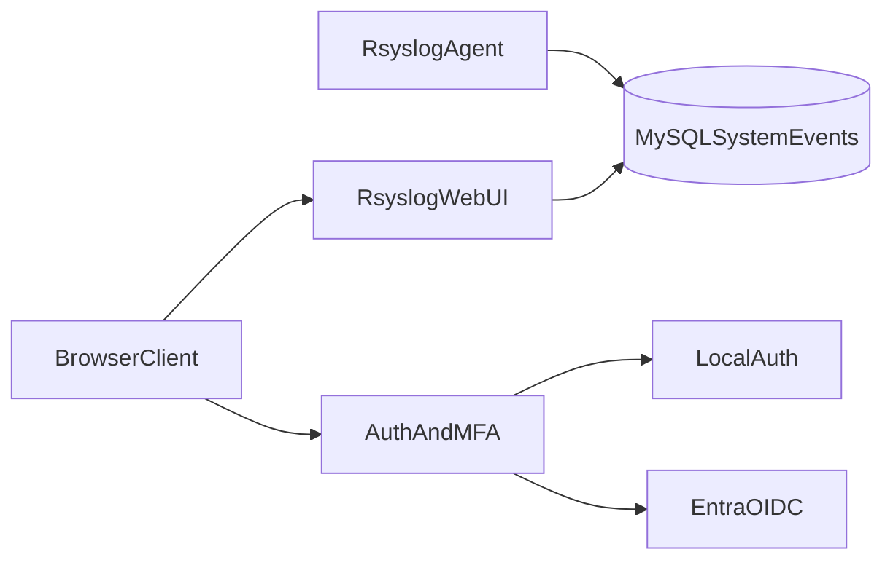

# Architecture

`rsyslog-webui` reads syslog records from MySQL and provides a web UI with optional enterprise auth and MFA.

## System Overview

## Main Data Path

1. rsyslog writes events into `SystemEvents`.
2. UI endpoints (`json/events.php`, `json/events_summary.php`) query and shape event data.
3. Browser renders table, summaries, and live updates.

## Security Path

1. User signs in via local credentials or Entra OIDC.
2. MFA challenge applies (if enrolled/required).
3. Session established and scoped by role.
4. Admin pages expose privileged configuration and directory actions.

## Key Components

- `index.php`: main logs experience.
- `auth.php`: auth bootstrap and shared auth logic.
- `account/security.php`: MFA and account security controls.
- `includes/webauthn-rsyslog.php`: WebAuthn lifecycle.
- `admin/*`: directory and settings controls.
