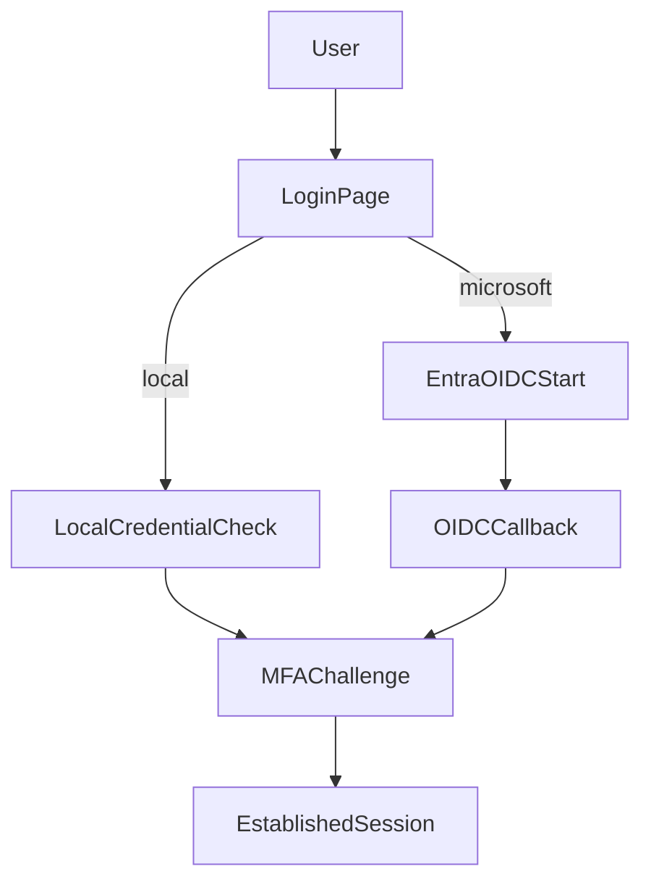

# Authentication and MFA

The project supports local auth and optional Microsoft Entra ID sign-in.

## Local Authentication

- Username/password stored in `Users`.
- Role mapping via `Roles` and `UserRoles`.
- Passwords hashed with bcrypt.
- Admin directory management in `admin/users.php`.

## Entra ID Sign-In (OIDC + PKCE)

Flow entrypoints:

- `auth/azure/start.php`
- `auth/azure/callback.php`

Required inputs:

- Tenant ID
- Client ID
- Client secret
- Redirect URI (`https://<host>/auth/azure/callback.php`)

## MFA

Methods:

- TOTP (authenticator apps)
- WebAuthn passkeys

Enrollment and management:

- `account/security.php`
- Challenge route: `mfa/challenge.php`

### Passkey Provider Compatibility

- Registration payloads are normalized server-side for multiple credential-manager shapes (including providers that emit base64url variants or byte-array fields).
- If registration fails, inspect `register-verify` JSON error `detail` for actionable reason (`malformed_credential`, `credential_decode_failed`, etc.).

## Password Reset and Email Verification

- Uses Microsoft Graph `sendMail` app permissions (`Mail.Send`).
- Sender mailbox configured with `RSYSLOG_GRAPH_MAIL_SENDER`.

## Auth Flow Diagram

## Hardening Notes

- Require strong secrets (`RSYSLOG_SESSION_SECRET`, `RSYSLOG_APP_SECRET`).
- Keep `RSYSLOG_AUTH_ENABLED=1` unless protected by a trusted upstream auth layer.
- Rotate Entra secrets if exposed.
