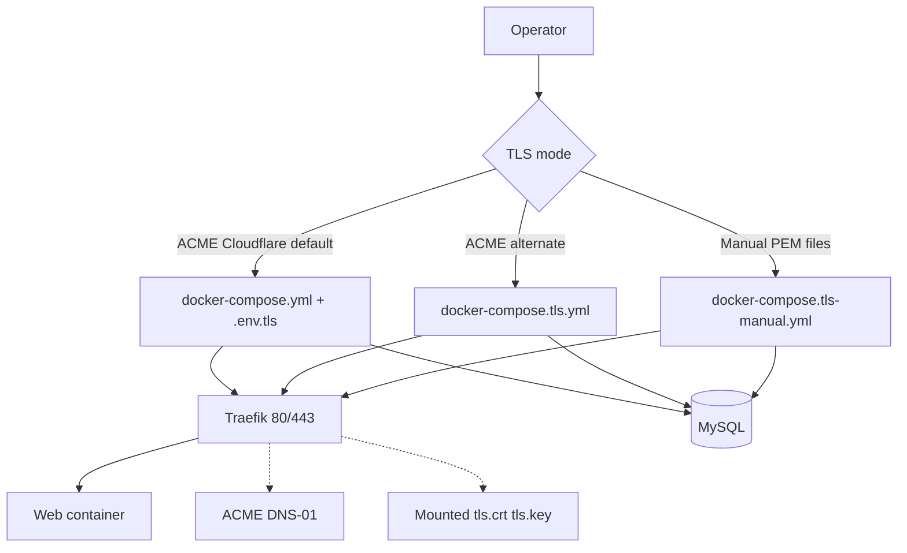

# Deployment

## Recommended Topology

- App container serves PHP/Apache.
- Reverse proxy handles TLS and forwarding headers.
- MySQL stores `SystemEvents` and auth tables.
- Optional network collector receives syslog on `5514` and inserts into MySQL.

## TLS: pick a mode

| Mode | Compose file | What you need |
| --- | --- | --- |
| **Automated** (Let’s Encrypt) — **default** | `docker-compose.yml` + `.env.tls` | Copy `docker/tls.env.example` → `.env.tls` (includes `COMPOSE_PROFILES=tls`). Run `docker compose --env-file .env.tls up -d --build`. Host **80/443** (Traefik) plus `WEB_PORT` → web. |
| **Automated** (alternate layout) | `docker-compose.tls.yml` | Same `.env.tls` variables; standalone `internal`/`edge` networks |
| **Automated** without `COMPOSE_PROFILES` in env | `docker-compose.yml` | Same `.env.tls` but pass `--profile tls` explicitly |
| **Manual** (your certs, **no Cloudflare API key**) | `docker-compose.tls-manual.yml` | PEM files at `docker/certs/tls.crt` and `docker/certs/tls.key` |

See **TLS option B** below for full manual steps, renewal, and file layout.

## TLS option A: Traefik + Cloudflare DNS-01 (automated certs)

1. Copy `docker/tls.env.example` to `.env.tls`.
2. Set:
   - `TLS_DOMAIN`
   - `ACME_EMAIL`
   - `CF_DNS_API_TOKEN`
   - strong app secrets
3. Start (recommended — `.env.tls` from the example already contains `COMPOSE_PROFILES=tls`):

   ```bash
   docker compose --env-file .env.tls up -d --build
   ```

   If you removed `COMPOSE_PROFILES=tls` from `.env.tls`, use:

   ```bash
   docker compose --env-file .env.tls --profile tls up -d --build
   ```

   Alternate standalone stack:

   ```bash
   docker compose --env-file .env.tls -f docker-compose.tls.yml up -d --build
   ```

Use only placeholder values in docs/examples (`logs.example.com`).

Cloudflare notes:

- DNS-only and proxied modes can both work; verify your chosen mode preserves expected client IP headers.
- If using proxied mode, ensure `CF-Connecting-IP` is forwarded and trusted in your edge path.

## TLS option B: Traefik + manual certificate (no Cloudflare API key)

**Use this path if you are not using Cloudflare DNS-01 / do not want to store a Cloudflare API token.** Certificates can come from a commercial CA, internal PKI, another ACME client, or any tool that outputs standard PEM files.

1. Put certificate files on the host:
   - `docker/certs/tls.crt`
   - `docker/certs/tls.key`
2. Copy `docker/tls.env.example` to `.env.tls` and set strong app secrets.
3. Start:

   ```bash
   docker compose --env-file .env.tls -f docker-compose.tls-manual.yml up -d --build
   ```

4. Verify:

   ```bash
   curl -I https://logs.example.com
   ```

**Manual cert operations:** Traefik reads the mounted files at container start. When the certificate expires, replace `tls.crt` / `tls.key` on the host and restart Traefik (for example `docker compose --env-file .env.tls -f docker-compose.tls-manual.yml restart traefik`). Do not commit real keys or certs to git (`docker/certs/` is gitignored except `.gitkeep`).

## Collector Behavior in Production

- The collector accepts incoming network syslog only (UDP/TCP `5514`).
- It does not seed fake/demo data.
- Restrict `5514` and the published MySQL port (default host `3306`, or your `MYSQL_HOST_PORT`) to trusted source networks using host firewall/security groups.

## Deployment Flow Diagram



## Production Checklist

- [ ] TLS enabled; renewal validated (ACME) or rotation process documented (manual certs).
- [ ] `RSYSLOG_SESSION_SECRET` rotated from defaults.
- [ ] `RSYSLOG_APP_SECRET` set and rotated policy documented.
- [ ] Local MFA policy decision documented and applied.
- [ ] Login rate-limit behavior validated.
- [ ] Entra/Graph secrets stored in secure secret manager.
- [ ] Backups for MySQL + restore drill tested.
- [ ] Health checks and log monitoring in place.

## Reverse Proxy Notes

- Forward `X-Forwarded-Proto` and `X-Forwarded-Host`.
- Ensure application sees secure origin for auth/cookie behavior.
- Restrict direct app port exposure when using a public proxy.

## Static asset caching (Docker Apache image)

The web image enables `mod_expires` / `mod_headers` with `docker/apache/static-cache.conf`: common static extensions get about a 7-day `Cache-Control`; `.php` stays `no-store`. Filenames are not fingerprinted—plan refreshes or renames when shipping breaking CSS/JS.

## Cloudflare proxy and Lighthouse

If the hostname is behind Cloudflare, **Rocket Loader** often shows as render-blocking in PageSpeed/Lighthouse. Disable Rocket Loader for the zone (or scope a rule to the log UI hostname) for cleaner lab scores; that is a CDN toggle, not an app change.
