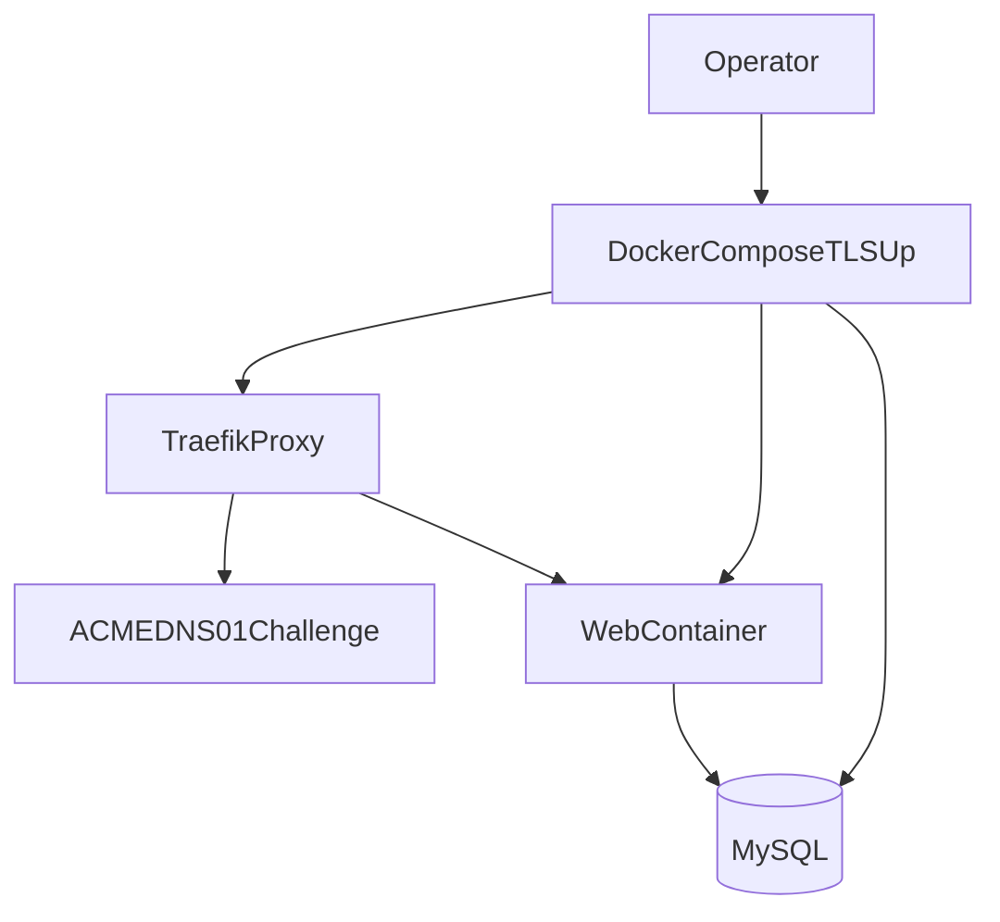

# Deployment

## Recommended Topology

- App container serves PHP/Apache.
- Reverse proxy handles TLS and forwarding headers.
- MySQL stores `SystemEvents` and auth tables.
- Optional network collector receives syslog on `5514` and inserts into MySQL.

## TLS with Traefik + Cloudflare DNS-01

1. Copy `docker/tls.env.example` to `.env.tls`.
2. Set:
   - `TLS_DOMAIN`
   - `ACME_EMAIL`
   - `CF_DNS_API_TOKEN`
   - strong app secrets
3. Start:

   ```bash
   docker compose --env-file .env.tls -f docker-compose.tls.yml up -d --build
   ```

Use only placeholder values in docs/examples (`logs.example.com`).

## Collector Behavior in Production

- The collector accepts incoming network syslog only (UDP/TCP `5514`).
- It does not seed fake/demo data.
- Restrict `5514` and `3308` to trusted source networks using host firewall/security groups.

## Deployment Flow Diagram



## Production Checklist

- [ ] TLS enabled and cert renewal validated.
- [ ] `RSYSLOG_SESSION_SECRET` rotated from defaults.
- [ ] `RSYSLOG_APP_SECRET` set and rotated policy documented.
- [ ] Entra/Graph secrets stored in secure secret manager.
- [ ] Backups for MySQL + restore drill tested.
- [ ] Health checks and log monitoring in place.

## Reverse Proxy Notes

- Forward `X-Forwarded-Proto` and `X-Forwarded-Host`.
- Ensure application sees secure origin for auth/cookie behavior.
- Restrict direct app port exposure when using a public proxy.
